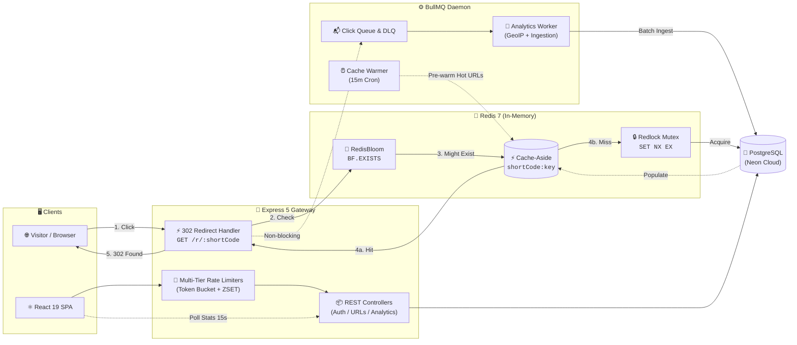

# ⚡ shortr — Distributed URL Shortener & Real-Time Analytics Engine

[](https://www.typescriptlang.org/)
[](https://react.dev/)
[](https://nodejs.org/)
[](https://expressjs.com/)
[](https://neon.tech/)
[](https://redis.io/)
[](https://bullmq.io/)
[](https://tailwindcss.com/)
[](LICENSE)

> A high-throughput, developer-first URL shortener and telemetry platform built with sub-50ms redirect hot paths, RedisBloom cache penetration guards, Redlock concurrency locks, asynchronous BullMQ click ingestion, multi-tier rate limiting, and an Obsidian-styled real-time analytics dashboard.

---

## 📖 Table of Contents

- [Overview](#-overview)
- [Key Features](#-key-features)
- [System Architecture](#-system-architecture)
  - [1. Sub-50ms Redirection Hot Path](#1-sub-50ms-redirection-hot-path)
  - [2. Asynchronous Click Telemetry Pipeline](#2-asynchronous-click-telemetry-pipeline)
  - [3. Mermaid Architecture Diagram](#3-mermaid-architecture-diagram)
- [Tech Stack](#-tech-stack)
- [Multi-Tier Rate Limiting](#-multi-tier-rate-limiting)
- [Prerequisites](#-prerequisites)
- [Environment Variables](#-environment-variables)
- [Installation & Local Setup](#-installation--local-setup)
- [API Reference & Usage](#-api-reference--usage)
  - [System Health](#system-health)
  - [Public Redirection](#public-redirection)
  - [URL Management](#url-management)
  - [Analytics](#analytics)
  - [Authentication & Verification](#authentication--verification)
- [Folder Structure](#-folder-structure)
- [Deployment](#-deployment)
- [Contributing](#-contributing)
- [License](#-license)

---

## 🔭 Overview

Modern URL shorteners face demanding operational challenges: handling millions of concurrent redirection queries with sub-50ms latency while guarding against distributed cache stampedes, malicious cache penetration, and blocking database bottlenecks during click analytics ingestion.

**shortr** solves these challenges through a distributed, layered architecture:
1. **Zero-Wait Redirection Hot Path:** Combines probabilistic **RedisBloom filters** to instantly short-circuit non-existent short codes, **Redis cache-aside** for sub-millisecond memory resolution, and **distributed locks with atomic Lua scripts** to prevent thundering herd database contention on cache misses.
2. **Decoupled Telemetry Ingestion:** Every click immediately returns an `HTTP 302 Found` with **zero synchronous database writes**. Click metadata (IP address, User-Agent, referrers, and timestamps) is streamed to an asynchronous **BullMQ** worker daemon that performs GeoIP resolution and batched persistence to PostgreSQL with Dead Letter Queue (DLQ) fault tolerance.
3. **Linear & Dub.co-Inspired UX:** Built with an Obsidian dark palette (`#0b0b0c`), fluid Framer Motion spring physics, real-time polling analytics, interactive animated system diagrams, keyset cursor pagination with instant search, and a live client-side countdown timer for sliding token bucket rate limits.

---

## ✨ Key Features

- **⚡ Sub-50ms Redirect Hot Path:** Cache-aside lookups served directly from in-memory Redis, ensuring minimal latency without stressing primary database pools.
- **🛡️ Probabilistic Bloom Filter (`RedisBloom`):** Eliminates cache penetration by checking code existence in memory (`BF.EXISTS`) before touching Redis keys or PostgreSQL. Fails open gracefully under transient faults.
- **🔒 Distributed Rebuild Lock (Redlock Pattern):** Protects against cache stampedes/thundering herd problems. When a cache miss occurs, only one worker acquires a Redis mutex lock (`SET NX EX`) to populate the cache; concurrent requests poll the cache rather than hammering the database. Lock release is verified via an atomic Lua script.
- **📊 Non-Blocking Click Telemetry (BullMQ):** Decouples redirects from analytics. Click events are pushed to an asynchronous Redis queue with automatic retries and Dead Letter Queue (`analytics-dead-letter-queue`) fallback.
- **🔥 Proactive Cache Warmer:** A recurring BullMQ cron scheduler queries the top N most-clicked links and warms the cache before TTL expiration, preventing cold misses on viral links.
- **🚦 Multi-Tier Distributed Rate Limiting:**
  - *Tier 1 (Global):* Fixed-window Redis limiter protecting the entire API surface (health checks excluded).
  - *Tier 2 (Login Brute Force):* Sliding-window Redis Sorted Set (`ZSET`) limiter for credential verification.
  - *Tier 3 (Short Link Creation):* Token bucket algorithm granting burst capacity (10 links) with automatic refill (1 token every 2s). Returns `429` with `retryAfterMs` rendered as a live UI countdown.
  - *Tier 4 (Email Abuse Guard):* Dual-key sliding-window limiter on password reset and verification endpoints, keying by both target email and client IP to prevent mailbox bombing and provider quota depletion.
- **🔐 Enterprise Authentication & Email Verification:**
  - JWT Access (`15m`) & Refresh (`7d`) tokens managed in HTTP-only, secure cookies.
  - Transparent silent token refreshing with queued failed-request replaying via Axios interceptors.
  - High-entropy, single-use SHA-256 hashed verification and password-reset tokens delivered via Brevo Transactional Email.
  - Account security: unverified users can log in and browse their dashboard, but short URL creation is strictly gated by `requireVerifiedEmail` (returns `403` with `errorCode: "EMAIL_NOT_VERIFIED"`).
- **📈 Real-Time Deep Analytics:** Keyset cursor-paginated dashboards, time-series click charts, geographic country distribution via `geoip-lite`, device breakdown, top referrers, and live event streams.

---

## 🏗️ System Architecture

### 1. Sub-50ms Redirection Hot Path
```
Client Request (GET /r/:shortCode)
  │
  ├──► [1] Bloom Filter Check (RedisBloom: BF.EXISTS)
  │      └── False ──► Immediate 404 (Zero DB/Cache lookup)
  │
  ├──► [2] Redis Cache Lookup (shortCode:<code>)
  │      └── Cache HIT ──► Immediate 302 Found
  │
  └──► [3] Cache MISS ──► Acquire Distributed Lock (SET shortCode:lock NX EX 5)
         ├── Lock Acquired ──► Read PostgreSQL ──► Set Cache (TTL + Jitter) ──► Release Lock (Lua)
         └── Lock Busy ──────► Poll Cache for Rebuild ──► Fallback to DB if timeout
```

### 2. Asynchronous Click Telemetry Pipeline
```
302 Redirect Issued ──► Enqueue Click Event (BullMQ: analytics-queue)
                             │
                             ▼
                    [BullMQ Worker Pool]
                             │
         ┌───────────────────┴───────────────────┐
         ▼                                       ▼
  GeoIP Resolution (geoip-lite)          User-Agent & Referrer Parsing
         │                                       │
         └───────────────────┬───────────────────┘
                             ▼
                 PostgreSQL (click_analytics)
                             │
                 [Failure / Exhausted Retries]
                             ▼
           Dead Letter Queue (analytics-dead-letter-queue)
```

### 3. Mermaid Architecture Diagram



---

## 🛠️ Tech Stack

| Category | Technology | Purpose & Details |
| :--- | :--- | :--- |
| **Frontend Core** | **React 19** + **TypeScript 5** | High-performance SPA with concurrent rendering features |
| **Build Tooling** | **Vite 6** | Instant HMR development server and optimized rollup bundling |
| **Styling & Motion** | **Tailwind CSS 3.4** + **Framer Motion 12** | Custom Obsidian dark design system, micro-interactions & physics |
| **State & Data Fetching** | **TanStack Query v5** | Server state caching, optimistic mutations, 15s polling intervals |
| **UI Primitives** | **Radix UI** + **Lucide Icons** | Accessible dialogs, dropdowns, tooltips, accordions, and icons |
| **Backend Core** | **Express 5** + **Node.js 20+** | Modern HTTP server with native async error routing |
| **Database ORM** | **Prisma ORM 6** | Type-safe schema definition, relations, migrations, and queries |
| **Primary Database** | **PostgreSQL (Neon Cloud)** | Relational store with keyset-indexed short URLs and click logs |
| **Cache & Concurrency** | **Redis 7 (RedisBloom)** | In-memory cache-aside, probabilistic Bloom filter, distributed lock |
| **Job Queue & Workers** | **BullMQ 6** | Distributed background queues, worker daemon, DLQ, cron scheduler |
| **Security & Auth** | **JWT** + **bcrypt** + **Helmet** | HTTP-only cookie tokens, password hashing, secure HTTP headers |
| **Email Service** | **Brevo (Sendinblue) API** | Transactional delivery of email verification & password reset tokens |
| **Observability** | **Pino** + **pino-pretty** | High-throughput structured JSON logging |

---

## 🚦 Multi-Tier Rate Limiting

The platform implements an advanced multi-tier defense in depth:

```
┌────────────────────────────────────────────────────────────────────────┐
│ Tier 1: Global Fixed Window (All Endpoints, /health Excluded)          │
│ 100 requests per 15 minutes per IP                                     │
└───────────────────────────────────┬────────────────────────────────────┘
                                    │
       ┌────────────────────────────┼────────────────────────────┐
       ▼                            ▼                            ▼
┌─────────────────────────┐  ┌─────────────────────────┐  ┌─────────────────────────┐
│ Tier 2: Login Guard     │  │ Tier 3: Token Bucket    │  │ Tier 4: Email Abuse     │
│ 5 attempts / 15 min / IP│  │ 10 tokens burst capacity│  │ 3 attempts / 15 min     │
│ Redis Sorted Sets (ZSET)│  │ Refill: 1 token / 2000ms│  │ Dual-Key: IP & Email    │
│ Mitigates brute-force   │  │ Live UI countdown timer │  │ Stops inbox flooding    │
└─────────────────────────┘  └─────────────────────────┘  └─────────────────────────┘
```

---

## 📋 Prerequisites

Before setting up the project locally, ensure you have the following installed:

- **Node.js**: `v20.x` or higher
- **npm**: `v9.x` or higher
- **Docker Desktop**: Required to run Redis with the `RedisBloom` module
- **PostgreSQL**: Local PostgreSQL instance OR a free cloud instance from [Neon](https://neon.tech/)
- **Brevo Account**: (Optional for local dev, required for real emails) Free API key from [Brevo](https://www.brevo.com/)

---

## 🔐 Environment Variables

### Backend Configuration (`backend/.env`)

| Variable | Description | Type / Default | Required |
| :--- | :--- | :--- | :---: |
| `NODE_ENV` | Application environment (`development` / `production` / `test`) | `development` | No |
| `PORT` | HTTP server listening port | `4000` | No |
| `FRONTEND_URL` | Frontend origin for CORS and email verification links | `http://localhost:3000` | **Yes** |
| `RUN_WORKER_IN_PROCESS` | Run BullMQ workers inside the API process (useful for Render free tier) | `false` | No |
| `DATABASE_URL` | PostgreSQL connection string | `postgresql://...` | **Yes** |
| `SALT_ROUNDS` | Bcrypt hashing rounds for user passwords | `10` | No |
| `ACCESS_TOKEN_SECRET` | Secret key for signing short-lived JWT access tokens | String (min 32 chars) | **Yes** |
| `REFRESH_TOKEN_SECRET`| Secret key for signing long-lived JWT refresh tokens | String (min 32 chars) | **Yes** |
| `ACCESS_TOKEN_EXPIRES_IN` | JWT access token lifespan | `15m` | No |
| `REFRESH_TOKEN_EXPIRES_IN`| JWT refresh token lifespan | `7d` | No |
| `URL_SHORTCODE_LENGTH` | Length of generated short codes (nanoid) | `8` | No |
| `REDIS_HOST` | Redis host address | `localhost` | **Yes** |
| `REDIS_PORT` | Redis port number | `6379` | **Yes** |
| `REDIS_PASSWORD` | Redis authentication password | String | No |
| `URL_CACHE_TTL` | Base Redis cache TTL for short URLs (in seconds) | `300` | **Yes** |
| `JITTER_PERCENT` | Random jitter percentage applied to cache TTL to prevent cache stampedes | `0.1` (10%) | **Yes** |
| `LOCK_TTL_SECONDS` | Distributed lock lease time for cache rebuilds | `5` | No |
| `HOT_URL_CACHE_TTL_HOURS` | Cache TTL for proactive cache warmer targets | `24` | No |
| `CACHE_WARMER_EVERY_MINUTES` | Recurrence interval for cache warmer worker cron | `15` | No |
| `WARM_HOT_URLS_LIMIT` | Number of most-clicked links to re-warm every cycle | `50` | No |
| `GLOBAL_RATE_LIMIT_WINDOW` | Tier 1 rate limit window (in minutes) | `15` | No |
| `GLOBAL_RATE_LIMIT_SIZE` | Tier 1 max requests per window | `100` | No |
| `LOGIN_RATE_LIMIT_WINDOW` | Tier 2 login attempt window (in minutes) | `15` | No |
| `LOGIN_RATE_LIMIT_SIZE` | Tier 2 maximum login attempts | `5` | No |
| `SHORT_URL_TOKEN_BUCKET_CAPACITY` | Tier 3 token bucket burst capacity | `10` | No |
| `SHORT_URL_TOKEN_REFILL_RATE` | Tokens added per refill interval | `1` | No |
| `SHORT_URL_TOKEN_REFILL_INTERVAL` | Milliseconds between token refills | `2000` | No |
| `FORGOT_PASSWORD_RATE_LIMIT_WINDOW` | Tier 4 forgot password rate limit window (in minutes) | `15` | No |
| `FORGOT_PASSWORD_RATE_LIMIT_SIZE` | Tier 4 maximum forgot password attempts | `3` | No |
| `RESEND_VERIFICATION_RATE_LIMIT_WINDOW` | Tier 4 resend verification rate limit window (in minutes) | `15` | No |
| `RESEND_VERIFICATION_RATE_LIMIT_SIZE` | Tier 4 maximum resend verification attempts | `3` | No |
| `BREVO_API_KEY` | Brevo API key for transactional email | String | **Yes** |
| `BREVO_SENDER_EMAIL` | Verified sender address on Brevo | Email string | **Yes** |
| `BREVO_SENDER_NAME` | Sender name shown in verification emails | `shortr` | No |
| `EMAIL_VERIFICATION_TOKEN_EXPIRES_IN` | Verification token validity window | `24h` | No |
| `PASSWORD_RESET_TOKEN_EXPIRES_IN` | Password reset token validity window | `30m` | No |

### Frontend Configuration (`frontend/.env`)

| Variable | Description | Type / Default | Required |
| :--- | :--- | :--- | :---: |
| `VITE_API_URL` | Backend API URL base. Leave empty in local dev to use Vite's proxy | `""` (proxies to port 4000) | No |
| `VITE_SHORT_URL_BASE` | Base URL used when copying short links and rendering QR codes | `http://localhost:3000` | No |

---

## 🚀 Installation & Local Setup

### 1. Clone the Repository
```bash
git clone https://github.com/sharthak06/URL_Shortner.git
cd URL_Shortner
```

### 2. Start Redis Stack with RedisBloom via Docker
> [!IMPORTANT]
> The backend requires the **RedisBloom** module (`BF.*` commands). Plain `redis:7-alpine` will fail on startup. Use `redis/redis-stack`:

```bash
docker run -d --name url-redis -p 6379:6379 -p 8001:8001 redis/redis-stack:latest
```
*(Optional: Open `http://localhost:8001` in your browser to inspect Redis keys and Bloom filters via the RedisInsight dashboard).*

### 3. Backend Setup
```bash
cd backend

# Install dependencies
npm install

# Copy environment configuration template
cp .env.example .env
# Edit .env with your PostgreSQL DATABASE_URL, Redis, and secret keys

# Push Prisma schema to the database & generate Prisma client
npx prisma db push
npx prisma generate
```

### 4. Frontend Setup
```bash
cd ../frontend

# Install dependencies
npm install

# Copy environment configuration template (optional for local dev)
cp .env.example .env
```

### 5. Running the Application Locally
Running the complete platform locally requires three terminal windows:

#### Terminal 1: Backend Express API Server
```bash
cd backend
npm run dev
# Starts API server on http://localhost:4000
```

#### Terminal 2: BullMQ Background Worker Daemon
```bash
cd backend
npm run worker
# Boots analytics ingestion worker + recurring cache warmer
```

#### Terminal 3: Frontend Client
```bash
cd frontend
npm run dev
# Starts Vite dev server on http://localhost:3000 (proxies /api and /r to :4000)
```

Now open [http://localhost:3000](http://localhost:3000) in your browser.

---

## 📡 API Reference & Usage

### System Health

#### `GET /health` or `GET /api/v1/health`
Service liveness and readiness probe. Excluded from global rate limiting.
- **Response (`200 OK`):**
  ```json
  {
    "status": "ok",
    "message": "Server is healthy",
    "timestamp": "2026-10-12T01:00:00.000Z",
    "uptime": 124.5
  }
  ```

#### `GET /health/db` or `GET /api/v1/health/db`
PostgreSQL connectivity probe.
- **Response (`200 OK`):**
  ```json
  {
    "status": "ok",
    "database": "connected",
    "timestamp": "2026-10-12T01:00:00.000Z"
  }
  ```

---

### Public Redirection

#### `GET /r/:shortCode`
Executes an ultra-fast temporary redirect (`302 Found`). Dispatches click telemetry asynchronously to BullMQ with 0 synchronous database writes.

- **Response:** `HTTP 302 Found` with `Location: <destinationUrl>`
- **Error:** `HTTP 404 Not Found` if the Bloom filter or database confirms non-existence.

---

### URL Management

#### `POST /api/v1/urls` (or `POST /api/v1/urls/create-short-url`)
Creates a new shortened URL. Requires authentication, a verified email, and respects the token bucket rate limiter.

- **Headers:** `Cookie: accessToken=...` or `Authorization: Bearer <token>`
- **Request Body:**
  ```json
  {
    "originalUrl": "https://developer.mozilla.org/en-US/docs/Web/JavaScript"
  }
  ```
- **Response (`201 Created`):**
  ```json
  {
    "success": true,
    "message": "Short URL created successfully",
    "data": {
      "id": "cm81x0k0v00003b6w52e4w1t9",
      "userId": "usr_99f345a2-c488-4217-a065",
      "originalUrl": "https://developer.mozilla.org/en-US/docs/Web/JavaScript",
      "shortCode": "k9X1mZ7p",
      "clickCount": 0,
      "createdAt": "2026-10-12T01:00:00.000Z",
      "updatedAt": "2026-10-12T01:00:00.000Z"
    }
  }
  ```
- **Email Not Verified (`403 Forbidden`):**
  ```json
  {
    "status": "fail",
    "message": "Please verify your email address before creating short links",
    "errorCode": "EMAIL_NOT_VERIFIED"
  }
  ```
- **Token Bucket Rate Limit Exceeded (`429 Too Many Requests`):**
  ```json
  {
    "success": false,
    "error": "Rate limit exceeded",
    "retryAfterMs": 1820,
    "message": "Too many URL creation requests. Burst limit reached. Please wait before creating more links."
  }
  ```

#### `GET /api/v1/urls`
Fetches a keyset-paginated list of the authenticated user's short links with optional search filtering.

- **Query Parameters:**
  - `limit` *(optional, default 10, max 100)*: Items per page.
  - `cursor` *(optional)*: Base64-encoded cursor token `{createdAt, id}` for next page.
  - `search` *(optional, max 200 chars)*: Case-insensitive query matching short codes or destination URLs.
- **Response (`200 OK`):**
  ```json
  {
    "success": true,
    "message": "User URLs fetched successfully",
    "data": {
      "items": [
        {
          "id": "cm81x0k0v00003b6w52e4w1t9",
          "userId": "usr_99f345a2-c488-4217-a065",
          "shortCode": "k9X1mZ7p",
          "originalUrl": "https://developer.mozilla.org",
          "clickCount": 42,
          "createdAt": "2026-10-12T01:00:00.000Z",
          "updatedAt": "2026-10-12T01:00:00.000Z"
        }
      ],
      "nextCursor": "eyJjcmVhdGVkQXQiOiIyMDI2LTEwLTEyVDAxOjAwOjAwLjAwMFoiLCJpZCI6ImNtODF4...\"",
      "hasMore": false
    }
  }
  ```

#### `GET /api/v1/urls/stats`
Fetches account-level aggregate metrics for the dashboard header.

- **Response (`200 OK`):**
  ```json
  {
    "success": true,
    "message": "User URL stats fetched successfully",
    "data": {
      "totalLinks": 14,
      "totalClicks": 1289,
      "topLink": {
        "id": "cm81x0k0v00003b6w52e4w1t9",
        "shortCode": "k9X1mZ7p",
        "originalUrl": "https://developer.mozilla.org",
        "clickCount": 420
      }
    }
  }
  ```

#### `PATCH /api/v1/urls/:shortCode`
Updates the destination URL for an existing link owned by the user. Automatically updates the database and cache.

- **Request Body:**
  ```json
  {
    "updatedOriginalUrl": "https://developer.mozilla.org/en-US/docs/Web/TypeScript"
  }
  ```
- **Response (`200 OK`):**
  ```json
  {
    "success": true,
    "message": "Original URL updated successfully",
    "data": {
      "id": "cm81x0k0v00003b6w52e4w1t9",
      "shortCode": "k9X1mZ7p",
      "originalUrl": "https://developer.mozilla.org/en-US/docs/Web/TypeScript"
    }
  }
  ```

#### `DELETE /api/v1/urls/:shortCode`
Deletes an existing short link (supports passing `shortCode` or database `id`). Deletes the record from PostgreSQL and invalidates the Redis cache key.

- **Response (`200 OK`):**
  ```json
  {
    "success": true,
    "message": "Short URL deleted successfully"
  }
  ```

---

### Analytics

#### `GET /api/v1/urls/:id/analytics` (or `GET /api/v1/analytics/:id`)
Fetches deep-dive telemetry metrics for a short link. Accepts either the short link CUID `id` or the `shortCode`.

- **Query Parameters:**
  - `limit` *(optional, default 10, max 100)*: Click log sample size.
  - `cursor` *(optional)*: Base64-encoded cursor token `{clickedAt, id}`.
- **Response (`200 OK`):**
  ```json
  {
    "success": true,
    "message": "Link analytics retrieved successfully",
    "data": {
      "shortUrlId": "cm81x0k0v00003b6w52e4w1t9",
      "totalClicks": 420,
      "topCountries": [
        { "country": "US", "count": 210 },
        { "country": "DE", "count": 85 }
      ],
      "topReferrers": [
        { "referrer": "twitter.com", "count": 190 },
        { "referrer": "linkedin.com", "count": 115 }
      ],
      "clicks": {
        "items": [
          {
            "id": "cm81y9x0v00003b6w52e4w1t0",
            "shortUrlId": "cm81x0k0v00003b6w52e4w1t9",
            "ipAddress": "192.168.1.1",
            "userAgent": "Mozilla/5.0 (Windows NT 10.0; Win64; x64)...",
            "referrer": "twitter.com",
            "country": "US",
            "clickedAt": "2026-10-12T01:00:00.000Z"
          }
        ],
        "nextCursor": null,
        "hasMore": false
      }
    }
  }
  ```

---

### Authentication & Verification

| Method | Endpoint | Description |
| :--- | :--- | :--- |
| `POST` | `/api/v1/auth/register` | Register user account; sends transactional verification email |
| `POST` | `/api/v1/auth/login` | Log in user with HTTP-only JWT cookies (sliding-window rate limited) |
| `POST` | `/api/v1/auth/refresh` | Silently issue fresh access token using refresh token cookie |
| `POST` | `/api/v1/auth/logout` | Clear session cookies |
| `GET` | `/api/v1/auth/me` | Fetch authenticated user session and verification status |
| `POST` | `/api/v1/auth/verify-email` | Validate single-use verification token (`{ token }`) |
| `POST` | `/api/v1/auth/resend-verification` | Send a fresh verification link (`{ email }`, dual-key rate limited, enumeration-safe) |
| `POST` | `/api/v1/auth/forgot-password` | Request password reset email (`{ email }`, dual-key rate limited, enumeration-safe) |
| `POST` | `/api/v1/auth/reset-password` | Update account password using single-use token (`{ token, newPassword }`) |

---

## 📂 Folder Structure

```
Url_Shortner/
├── backend/
│   ├── prisma/
│   │   └── schema.prisma              # PostgreSQL schema (Users, ShortURLs, Analytics, Tokens)
│   ├── src/
│   │   ├── config/                    # Zod env schema validation & Pino logger
│   │   ├── lib/                       # Prisma client & ioredis connection singletons
│   │   ├── middlewares/
│   │   │   ├── auth.middleware.ts     # Dual JWT cookie / Bearer parser with auto-refresh
│   │   │   ├── requireVerifiedEmail.ts# Guard blocking short URL creation for unverified accounts
│   │   │   └── rate-limit/            # Multi-tier rate limiting (global, login, token-bucket, email)
│   │   ├── modules/                   # Layered domain architecture
│   │   │   ├── analytics/             # Ingestion queries, time-series aggregation
│   │   │   ├── auth/                  # Registration, login, verification, password reset
│   │   │   ├── bloom/                 # RedisBloom filter service (BF.RESERVE, BF.ADD, BF.EXISTS)
│   │   │   ├── health/                # Service health & readiness probes
│   │   │   ├── lock/                  # Distributed lock service (Redlock SET NX EX + Lua script)
│   │   │   └── url/                   # Shortlink CRUD, cache-aside logic, keyset pagination
│   │   ├── queues/                    # BullMQ queue definitions & Dead Letter Queue handlers
│   │   ├── workers/                   # BullMQ workers (click ingestion & proactive cache warmer)
│   │   ├── app.ts                     # Express 5 application setup, middlewares, and route tree
│   │   ├── server.ts                  # HTTP API entrypoint
│   │   └── starter-worker.ts          # Dedicated background worker daemon entrypoint
│   └── package.json
│
├── frontend/
│   ├── src/
│   │   ├── api/                       # Axios client with 401 transparent token-refresh queue
│   │   ├── components/
│   │   │   ├── analytics/             # Spline charts, country & device breakdown cards
│   │   │   ├── auth/                  # Shared AuthShell, form cards, password reveal
│   │   │   ├── dashboard/             # Stats strip, link feed, instant search, copy modals
│   │   │   ├── landing/               # Hero preview generator, animated architecture diagram, FAQ
│   │   │   └── ui/                    # Radix UI primitives styled with Obsidian tokens
│   │   ├── context/                   # AuthContext with session event listeners
│   │   ├── hooks/                     # TanStack Query hooks (useUrls, useUrlStats, useMediaQuery)
│   │   ├── lib/                       # Framer Motion transitions, URL sanitization, timeline & device helpers
│   │   ├── pages/                     # Lazy-loaded route views (Landing, Dashboard, Analytics, Auth)
│   │   ├── App.tsx                    # React Router v7 routes with Suspense code splitting
│   │   └── main.tsx                   # React 19 root bootstrap
│   ├── tailwind.config.ts             # Obsidian palette tokens (#0b0b0c, #161618, #1e1e22)
│   ├── vite.config.ts                 # Port 3000 server with reverse proxies to :4000
│   └── package.json
│
├── render.yaml                        # Infrastructure-as-code blueprint for Render deployment
└── README.md
```

---

## 🚢 Deployment

The repository includes a production-ready `render.yaml` blueprint designed for deployment on [Render](https://render.com/):

- **Single Service Mode:** The build script compiles TypeScript, executes `npx prisma db push` to synchronize schemas with your cloud PostgreSQL (Neon), builds the React SPA with Vite, and copies the frontend bundle to `backend/dist/public` where Express serves it statically from the same domain.
- **In-Process Workers:** By setting `RUN_WORKER_IN_PROCESS="true"`, the BullMQ ingestion workers and cache warmer run inside the main Node.js process without requiring a paid second service on cloud free tiers.
- **External Stores:** Easily point your `DATABASE_URL` to [Neon](https://neon.tech/) and your Redis configuration to [Redis Cloud](https://redis.com/try-free/).

---

## 🤝 Contributing

Contributions, issues, and feature requests are welcome!

1. Fork the Project.
2. Create your Feature Branch:
   ```bash
   git commit -b feature/AmazingFeature
   ```
3. Commit your Changes:
   ```bash
   git commit -m "feat: add AmazingFeature"
   ```
4. Push to the Branch:
   ```bash
   git push origin feature/AmazingFeature
   ```
5. Open a Pull Request.

---

## 📄 License

This project is licensed under the **ISC License**. Feel free to use, modify, and distribute for personal and commercial projects.
